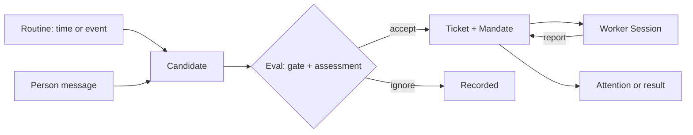

# Agent Note: Super-agent bots on DeepSeek Harness

Status: proposed

English | [中文](2026-11-06-super-agent-bots.zh.md)

## Problem

DeepSeek Harness runs one root Agent per conversation. A person opens a Session, prompts, reviews the result, and the work stops when the conversation does. Proactive work is limited to scheduled instructions ([Host-owned scheduled messages](../../implemented/architecture/2026-09-16-host-schedule-storage.md)) and, per the [event-triggered automation tasks](2026-10-29-event-triggered-automation-tasks.md) proposal, event tasks that judge in a read-only turn and notify. Neither provides a durable identity that owns routines, an authorized unit of unattended work, an attention budget, or per-agent capability grants.

Four products now ship that layer, and users have started to expect it from anything called an agent:

- **Grok Bots** make the agent a durable named teammate with its own conversation, routines that combine schedules and events, origin-aware approval expiry, and attention states rather than a notification feed ([docs](https://docs.x.ai/grok-bot/bots)).
- **OpenBots** gives each named teammate its own folder, memory, and deny-by-default permissions, and records consequential actions as immutable proposals that a person decides ([repository](https://github.com/LorenzoColombani/openbots)).
- **Claude Duet** leads with a proactive brief and a task ledger, finishes independent work while an approval is pending, and runs a risk check outside the model that is doing the work ([announcement](https://claude.com/resources/articles/claude-duet)).
- **OpenAI dots** separate capability grants from action policy, review every consequential action in a component the agent cannot reconfigure, and keep proactive research structurally read-only ([launch](https://openai.com/index/introducing-dots/)).

DeepSeek's own [Super-agent prototype](https://github.com/deepseek-ai/dsh-superagent-prototype) already implements that structure as a DeepSeek Harness bundle: a Source produces Triggers, an Eval decides, a Ticket carries a Mandate, an Executor Session runs it, and a panel shows what needs a person. Its published design is the reference for doing this here.

Today the harness is missing five things.

- **Identity.** A Session is the unit. Nothing durable carries a name, a job, memory, and permissions across sessions and restarts.
- **Work.** No record states why work may proceed, who authorized it, and how far it may go, so unattended work cannot be scoped or audited.
- **Attention.** A finished turn and a blocking question compete equally. There is no "needs you" state, no quiet hours, and no digest.
- **Autonomy.** An event turn can only propose; accepting a card runs one turn and stops. Nothing continues a piece of work across inputs, reviews, and restarts.
- **Governance.** Grants are per Session, not per agent; approval is per tool call with no origin-aware expiry and no way to pre-approve a declared scope.

The pieces now exist: `dsh-schedule` supplies time rules, the automation proposal supplies source providers and event triggers, `dsh-subagent` supplies durable child sessions, `dsh-user-approval` and action cards supply decisions, and `dsh-storage-domain` supplies validated durable records. What is missing is the composition, and the prototype proves it composes on DSH itself.

## Proposal

A **bot** is a durable record, not a Session. It owns a name, a job statement, a persona preset, a workspace root, capability grants, memory, routines, and one router Session. Work arrives from routines (time or event) or from a person messaging the bot. Each unit becomes a **ticket** with a **mandate**; a worker Session executes it; the person sees only attention items and results.

### Domain records

| Record | Meaning | Keeps |
|---|---|---|
| Bot | Durable identity | name, job, preset, workspace, grants, memory, router Session, status |
| Routine | When work may start | source parameters, instruction, accept mode |
| Candidate | One event or message under judgement | source, thread, gate strength, assessment, decision |
| Mandate | What an accept grants | scope, strength, matched rules, requester, policy version |
| Ticket | Unit of authorized work | stage, mandate, inputs, assignments, channels |
| Assignment | Binding of a ticket to one worker Session | start, delivered inputs, latest report |
| Attention | A thing that needs a person | kind, severity, ticket, expiry, decision |

Threads, Triggers, and Sources belong to the automation-trigger layer; this proposal consumes them rather than defining a second intake. Candidate and decision records reuse that layer's run records.

### Sessions

- **Router Session**, one per bot and long-lived. It carries routing tools, the bot's persona, and its memory index. It never runs a blocking command: no `sleep`, no shell timeout over 30 seconds, no job wait over 5 seconds. Reports, candidates, and completed jobs arrive as messages.
- **Worker Session**, one per ticket, created with the worker preset and a ticket working directory. It runs unattended, has no tool that asks a person or changes the profile, and reports `progress`, `waiting`, `ready`, `blocked`, or `failed` with at most one question.
- Both remain ordinary DSH Sessions: logged, projected, resumable, and openable from the sidebar. Their names are stable (`bot/<name>`, `bot/<name>/ticket-<id>`) so they can be found after a restart.

### Authorization

- The gate is deterministic: a per-source allowed list, whether the message addresses the bot, and a bot list for automated senders. Source text never changes permissions.
- Inferred work defaults to **observe**: the assessment records "would accept" and nothing starts. **Auto** is opt-in per routine, and only after the recorded decisions look right.
- A mandate records the policy version, scope, strength, matched rules, and requester. It is revalidated before a resumed ticket continues; a policy change notifies affected tickets without revoking live mandates.
- Source text is labeled untrusted before the model reads it, and a worker's prompt states that quoted content is data, not instructions.

### Execution

- Ticket stages, first match wins: needs a person (delivery failed, question, review, blocked, failed), queued, waiting for a next input, working.
- Each ticket holds one worker slot from launch through its turn; concurrency is a validated Config field; a person's message may use one extra slot so it never queues behind new work.
- A durable effect queue sits in front of storage: enqueue inside the transaction, perform after commit, retry with backoff, and recover unfinished work on startup with a recovery note.
- A turn that ends with shell jobs or subagents still running keeps its slot and wakes on their completion, within a configured cap. A handoff to a person frees the slot immediately.
- Restart recovery resumes running assignments oldest first, with a note telling the worker to check its directory, git history, and the source before repeating an outside action.

### Attention

- States are `needs_you`, `new_result`, `working`, and `quiet`. Only `needs_you` interrupts.
- One `ctx.attention` service owns items, and every item points at its Session. A notification carries no action payload.
- Policy is typed, not free text: quiet hours, digest cadence, escalation delay, per-bot and global daily caps, and which ticket stages may interrupt.
- A message is sent only when a person must act or can use a result. A healthy state takes no space.

### Approval

- A proposal record binds an immutable payload, a scope, a requester, and an expiry. A decision applies to that payload only; an expired, foreign, or edited proposal cannot be decided.
- Tiers follow reversibility and data sensitivity, not tool names: hand off to a person, confirm each time, or pre-approvable within a declared scope. A short hard floor is never pre-approvable.
- Interactive proposals wait; proposals raised by a routine or an incoming message expire, and the panel says so and offers "always allow next time".
- Rules are one action each, length-capped, countable, and an ask-first rule wins over an allow rule.
- A separate reviewer route evaluates risky actions before execution, with the acting model's conversation excluded from its input. `dsh-experimental-auto-review` is the starting point; it must gain an independent model route and a published statement of what it does not review.

### Memory

- Each bot has a Markdown memory with sections for standing rules, preferences, facts, and a dated work log.
- Writes go through one tool that records the source Session and the time; the panel shows every entry, and a user can edit or delete one.
- Summaries are labeled as snapshots, never promoted silently into facts.

### Panel

One sidebar entry per profile, then three questions in order: does anything need me, is the system healthy, what happened to one piece of work. Tabs are **Needs you**, **Bots**, **Threads**, **Runs**, and **Settings**. A row that needs a person offers its action inline; internal identifiers stay in folded detail.

### Packages

| Package | Role | Seam |
|---|---|---|
| `dsh-bot` | Bot records, lifecycle, memory, attention policy | `ctx.bots`, `ctx.attention` |
| `dsh-bot-work` | Candidates, mandates, tickets, assignments, executor, router and worker tools | `ctx.botWork` |
| `dsh-bot-source` | Source kind contract and intake over the automation trigger layer | `ctx.botSources` |
| `dsh-bot-source-github` | GitHub adapter: mentions, issues, pull request reviews and checks | registers one kind |
| `dsh-bot-panel` | Web panel and sidebar entry | client slots |
| `dsh-bot-bundle` | Patch layer, `bot-router` and `bot-worker` presets, defaults | bundle patch |

Start with `dsh-bot`, `dsh-bot-work`, and `dsh-bot-panel`; add a source package when a second adapter exists, and split a seam only when its roles evolve independently.

### Presets

- `bot-router`: routing tools only, the bot persona, the no-wait guard, and a cheap model route.
- `bot-worker`: file, search, shell, job, web, skill, todo, and subagent tools; no `ask_user_question`, `present`, or `plugin_manager`; `bot_report` and `bot_ack`.
- Persona per bot comes from `dsh-persona` inside a preset derived from `bot-router`; the bot record stores which preset revision it uses.

### Configuration

Every limit is a validated Config field: worker concurrency, turn background cap, effect retries, approval expiry per origin, rule counts, digest cadence, quiet hours, attention caps, retention. Nothing about deployment-varying behavior is a constant.

### Relationship to existing proposals

- This note builds on [event-triggered automation tasks](2026-10-29-event-triggered-automation-tasks.md): a routine is such a task, its source parameters and read-only judging turn are reused, and observe mode is that proposal's default path. This note adds identity, tickets, mandates, worker Sessions, attention policy, approvals, memory, and a roster. It does not supersede that note.
- Schedule remains the time source; subagent and agent team remain for one-shot delegation and shared task boards; the bot layer owns durable work across inputs, reviews, and restarts.
- It does not change the agent loop. Everything attaches to `ctx.agents`, tools, presets, storage domains, approval, action cards, and client slots.

### Delivery order

1. **Identity and attention.** Bot records, one router Session per bot, grants, `ctx.attention`, panel v1 with Needs you and Bots.
2. **Work.** Tickets, mandates, worker Sessions, reports, slots, restart recovery, panel Runs. Direct requests only; no proactive start yet.
3. **Proactive.** Routines over the trigger layer in observe mode, digest, quiet hours, approval expiry by origin, memory tool.
4. **Roster and governance.** Multiple bots, visible handoffs, independent reviewer, capability presets, retention and migration.

## Evidence from comparable products

| Product | Keep | Leave out |
|---|---|---|
| Grok Bots | Durable named agent; routines as one trigger object; approval expiry by origin; attention states; credentials resolved by reference | Avatar theater, a default bot that checks in unprompted, the email product, one shared VM treated as a security boundary |
| OpenBots | Per-bot permissions the agent cannot widen; immutable proposals; visible handoffs; memory labeled non-authoritative | macOS plumbing, chat-only intake, no scheduler, no notifications |
| Claude Duet | Proactive brief; task ledger separate from chat; deferred approval; risk check outside the acting model; a small hard floor | Consumer connectors and billing, a fixed multi-hour cadence, waitlist surfaces |
| OpenAI dots | Identity as a first-class record; capability grants separate from action policy; reviewer outside the agent; tiers by reversibility and data class; read-only proactive work | Pet avatars, product SKUs in the runtime, opaque memory, no digest, unshipped multi-agent claims |

The prototype contributes the parts the products leave implicit: a deterministic gate, mandates, observe-to-auto rollout, staged ticket lifecycle, durable effects, restart recovery, and a panel that shows only what waits for a person.

## Alternatives considered

**Extend the automation-task proposal instead of a new layer.** A task could grow tickets, worker Sessions, and approvals. It lost because the task record is a user-authored rule about when to look, while a bot is an identity with grants and memory that outlives any rule; merging them would make one record answer two questions, and it would put worker Sessions inside a feature that today only judges and notifies.

**One Session per bot, no router and worker split.** Fewer moving parts, and the conversation already holds context. It lost because unattended work over a long conversation reads an expired cache each turn, a blocked step delays every incoming candidate, and a single compromised input would run with the conversation's full history and permissions.

**Use subagents as workers.** They already have durable sessions, names, and presets. It lost for ticket work: a subagent tree belongs to one parent and is bounded by `maxActiveSubagents`, whereas a ticket must survive its creator, be reopenable, and appear in the sidebar as its own root Session. Subagents stay for one-shot research and review.

**One DSH profile per bot.** Total isolation and no new code. It lost because bots must share the person's workspace, credentials, and panel, and because every cross-bot handoff would cross a process boundary.

**Copy the prototype bundle wholesale.** It already works on DSH. It lost because it stores its own SQLite beside the harness, duplicates schedule, approval, and session concerns, and would fork every future improvement in those seams.

**Notify from code and skip the model.** Cheaper and silent. It lost because the notice would carry only a raw status; the model reads the logs and states the cause, and change-only delivery keeps those turns rare.

## Acceptance criteria

- A bot can be created, named, given a job and a preset, paused, resumed, and archived; its record and memory survive a restart.
- A person's message to the router Session creates exactly one ticket and one worker Session; a duplicate delivery creates none.
- Observe mode records a would-accept decision and starts no work; auto mode starts exactly one ticket per accepted candidate.
- A mandate records policy version, scope, strength, matched rules, and requester, and a policy change notifies affected tickets without revoking live mandates.
- A worker reports `ready`, `blocked`, `failed`, or `waiting` with at most one question, and the ticket stage follows without polling.
- A restart during an assignment resumes it oldest first with a recovery note, and no outside action is repeated without a checked result.
- The router Session refuses `sleep`, shell timeouts over 30 seconds, and job waits over 5 seconds.
- An attention item appears only for a stage that needs a person or a result a person can use, and every item links to its Session.
- Quiet hours, digest cadence, and daily caps are enforced from Config, and a cap produces one digest instead of dropped work.
- A proposal decision applies only to its exact payload; an expired, edited, or foreign proposal cannot be decided, and the refusal states why.
- A worker Session is offered no `ask_user_question`, `present`, or `plugin_manager` tool, and its tool set appears in the Session log.
- Replaying a Session log rebuilds every candidate, decision, report, and approval; the TypeScript and Python SDK expected outputs and a recorded-session snapshot cover the new model-visible surfaces.

## Risks

- **Attention failure is the product risk.** A bot that notifies too often is worse than no bot. Observe mode, typed severity, caps, and a digest limit the damage, but only prompt discipline and recorded decisions show whether it worked.
- **Duplication with the automation proposal.** Two records could describe the same routine. The boundary above keeps rules in the task record and work in tickets, and the first implementation must not grow a second intake.
- **Cost.** Background turns spend tokens with nobody watching. Per-bot daily budgets, idle pause, and a weekly pool are required before auto mode ships.
- **Prompt injection.** Source text drives work. Read-only judging, untrusted-text labeling, per-bot grants, the worker sandbox, and the reviewer reduce but do not remove it; the plan must not claim otherwise.
- **Approval fatigue and stranded work.** Background approvals expire, and an expired approval can strand work that has no alternative path. Deferred approval and a visible blocked state are required, not optional.
- **Session sprawl.** One Session per ticket multiplies storage and titles. Retention, archival, and naming need to land before multiple bots do.
- **Host-bound execution.** Nothing runs while the Host is stopped or the machine sleeps, unlike the hosted products. The plan must state this rather than imply always-on.
- **Experimental dependencies.** Action cards, auto review, and the automation trigger layer are experimental or proposed. Shipping the bot layer on them inherits their churn.
