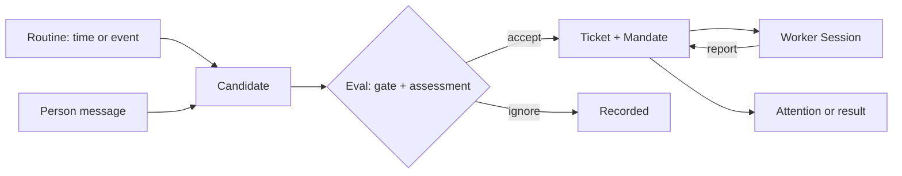

# Agent Note: DeepSeek Harness 上的超级智能体 Bot

Status: proposed

[English](2026-11-06-super-agent-bots.md) | 中文

## 问题

DeepSeek Harness 每个会话运行一个根 Agent。人打开会话、提问、审阅结果，对话结束后工作也就停止。主动工作目前只有两种：定时指令（[Host 拥有的定时消息](../../implemented/architecture/2026-09-16-host-schedule-storage.zh.md)），以及[事件触发的自动化任务](2026-10-29-event-triggered-automation-tasks.zh.md)提案中那种在只读轮次里判断再通知的事件任务。两者都没有提供一个持有例程的持久身份、一个获得授权的无人值守工作单元、一份注意力预算，也没有按 Bot 划分的能力授权。

已有四个产品提供了这一层，用户也开始期待任何被称为“智能体”的东西具备它：

- **Grok Bots** 把智能体做成有名字、有自己对话的持久队友，例程同时支持时间和事件，审批按来源决定是否过期，并用注意力状态代替通知流（[文档](https://docs.x.ai/grok-bot/bots)）。
- **OpenBots** 给每个有名字的队友自己的目录、记忆和默认拒绝的权限，并把有后果的动作记录为不可变的提案，由人裁决（[代码库](https://github.com/LorenzoColombani/openbots)）。
- **Claude Duet** 以主动简报和任务台账开场，在审批悬而未决时继续完成独立工作，并在执行模型之外运行风险检查（[公告](https://claude.com/resources/articles/claude-duet)）。
- **OpenAI dots** 把能力授权与动作策略分开，由智能体无法改写的组件审查每个有后果的动作，并让主动研究在结构上只读（[发布](https://openai.com/index/introducing-dots/)）。

DeepSeek 自己的[超级智能体原型](https://github.com/deepseek-ai/dsh-superagent-prototype)已经把这一结构实现为 DeepSeek Harness 的 bundle：Source 产生 Trigger，Eval 做出判断，Ticket 携带 Mandate，Executor Session 执行，面板只显示需要人处理的事。它公开的设计就是在这里实现该结构的参照。

今天这套 harness 缺五样东西。

- **身份。** 会话就是单位。没有任何持久记录跨会话、跨重启携带名字、职责、记忆和权限。
- **工作。** 没有记录说明工作为何可以进行、由谁授权、能走多远，因此无人值守的工作无法界定范围，也无法审计。
- **注意力。** 一个结束的轮次和一个阻塞的问题竞争同样的注意力。没有“需要你”状态，没有安静时段，也没有摘要。
- **自主性。** 事件轮次只能提议；接受卡片只跑一个轮次就结束。没有任何东西能让一件工作跨输入、评审和重启继续。
- **治理。** 授权按会话而不是按智能体；审批按工具调用，没有按来源的过期，也无法预先授权一个声明过的范围。

所需部件已经存在：`dsh-schedule` 提供时间规则，自动化任务提案提供来源提供者和事件触发器，`dsh-subagent` 提供可持久化的子会话，`dsh-user-approval` 和动作卡片提供决策，`dsh-storage-domain` 提供经过校验的持久记录。缺的是组合，而原型已经证明它能在 DSH 上组合出来。

## 提案

一个 **Bot** 是持久记录，不是会话。它持有名字、职责说明、人格 preset、工作区根目录、能力授权、记忆、例程，以及一个路由会话。工作来自例程（时间或事件），或来自人直接给 Bot 发消息。每个单元成为一个带有**授权**的**工单**；执行会话运行它；人只看到待处理事项和结果。

### 领域记录

| 记录 | 含义 | 保存 |
|---|---|---|
| Bot | 持久身份 | 名字、职责、preset、工作区、授权、记忆、路由会话、状态 |
| 例程 | 工作何时可以开始 | 来源参数、指令、接受模式 |
| 候选 | 一个正在判断的事件或消息 | 来源、线程、准入门禁强度、研判、决定 |
| 授权 | 接受所授予的内容 | 范围、强度、匹配规则、请求者、策略版本 |
| 工单 | 获得授权的工作单元 | 阶段、授权、输入、派工、渠道 |
| 派工 | 工单与一个执行会话的绑定 | 启动、已投递输入、最近报告 |
| 关注项 | 需要人处理的一件事 | 类型、严重程度、工单、过期、决定 |

线程、触发器和来源属于自动化触发器层；本提案消费它们，而不是另建一套接入。候选和决定记录复用该层的运行记录。

### 会话

- **路由会话**，每个 Bot 一个，长期存在。它持有路由工具、Bot 的人格和记忆索引。它从不运行阻塞命令：没有 `sleep`，shell 超时不超过 30 秒，作业等待不超过 5 秒。报告、候选和完成的作业以消息到达。
- **执行会话**，每个工单一个，用执行 preset 和工单工作目录创建。它无人值守运行，没有会询问人、展示界面或修改配置的工具，并且最多带一个问题地报告 `progress`、`waiting`、`ready`、`blocked` 或 `failed`。
- 两者仍是普通 DSH 会话：有日志、有投影、可恢复、可从侧栏打开。名字稳定（`bot/<name>`、`bot/<name>/ticket-<id>`），重启后仍能找到。

### 授权

- 准入门禁是确定性的：按来源的允许名单、消息是否指向 Bot，以及自动发送者的 Bot 名单。来源文本永远不改变权限。
- 推断出的工作默认进入**观察**模式：研判记录“本会接受”，但不启动任何工作。**自动**按例程逐个开启，而且只在记录下来的决定看起来正确之后。
- 授权记录策略版本、范围、强度、匹配规则和请求者。恢复工单继续之前重新校验；策略变更通知受影响的工单，但不撤销仍在进行的授权。
- 来源文本在模型读取之前标注为不可信，执行会话的提示说明引用内容是数据，不是指令。

### 执行

- 工单阶段按首个匹配：需要人（投递失败、提问、待评审、受阻、失败）、排队、等待下一个输入、执行中。
- 每个工单从启动到轮次结束持有一个执行槽位；并发数是经过校验的 Config 字段；人的消息可以使用一个额外槽位，永远不会排在新工作之后。
- 持久副作用队列位于存储之前：在事务内入队、提交后执行、失败退避重试，启动时恢复未完成工作并附恢复说明。
- 轮次结束仍有 shell 作业或子智能体运行时，它保留槽位并在其完成时被唤醒，上限可配置。交还给人时立即释放槽位。
- 重启恢复按最旧优先恢复运行中的派工，并附说明要求执行者先检查目录、git 历史和来源，再重复任何外部动作。

### 注意力

- 状态是 `needs_you`、`new_result`、`working`、`quiet`。只有 `needs_you` 打断。
- 一个 `ctx.attention` 服务持有条目，每条都指向其会话。通知不携带动作载荷。
- 策略是类型化的，不是自由文本：安静时段、摘要节奏、升级延迟、按 Bot 和全局的每日上限，以及哪些工单阶段可以打断。
- 只有在人必须行动或可以使用结果时才发消息。健康状态不占空间。

### 审批

- 审批提案记录绑定不可变载荷、范围、请求者和过期时间。决定只作用于该载荷；过期、越权或已修改的提案无法被决定。
- 层级按可逆性和数据敏感度划分，而不是按工具名：交给人、每次确认、或在声明范围内可预先批准。一小组硬性底线永远不可预先批准。
- 交互式提案一直等待；由例程或外部消息发起的提案会过期，面板说明这一点并提供“下次总是允许”。
- 规则每条只针对一个动作，有长度上限、可计数，询问优先的规则压过允许规则。
- 独立的审查路由在执行前评估有风险的动作，其输入不包含执行模型的对话。`dsh-experimental-auto-review` 是起点；它需要增加独立的模型路由，并公开说明它不审查什么。

### 记忆

- 每个 Bot 有一份 Markdown 记忆，分为长期规则、偏好、事实和带日期的工作日志。
- 写入只经过一个工具，记录来源会话和时间；面板显示每一条，用户可以编辑或删除。
- 摘要标注为快照，绝不静默提升为事实。

### 面板

每个 profile 一个侧栏入口，按顺序回答三个问题：是否有事需要我、系统是否健康、一件工作发生了什么。标签页为**待你处理**、**Bots**、**线程**、**运行**和**设置**。需要人的行直接给出动作；内部标识只出现在折叠详情里。

### 软件包

| 软件包 | 职责 | 接缝 |
|---|---|---|
| `dsh-bot` | Bot 记录、生命周期、记忆、注意力策略 | `ctx.bots`、`ctx.attention` |
| `dsh-bot-work` | 候选、授权、工单、派工、执行器、路由与执行工具 | `ctx.botWork` |
| `dsh-bot-source` | 来源类型契约，以及在自动化触发器层之上的接入 | `ctx.botSources` |
| `dsh-bot-source-github` | GitHub 适配器：提及、Issue、PR 评审和检查 | 注册一个类型 |
| `dsh-bot-panel` | Web 面板和侧栏入口 | 客户端插槽 |
| `dsh-bot-bundle` | 补丁层、`bot-router` 和 `bot-worker` preset、默认值 | bundle 补丁 |

先做 `dsh-bot`、`dsh-bot-work` 和 `dsh-bot-panel`；出现第二个适配器时再加来源包，只有当一个接缝的角色独立演进时才拆分它。

### Preset

- `bot-router`：只有路由工具、Bot 人格、禁止等待的守卫，以及便宜的模型路由。
- `bot-worker`：文件、搜索、shell、作业、Web、技能、待办和子智能体工具；没有 `ask_user_question`、`present` 或 `plugin_manager`；有 `bot_report` 和 `bot_ack`。
- 每个 Bot 的人格由 `dsh-persona` 从 `bot-router` 派生的 preset 提供；Bot 记录保存它使用的 preset 修订。

### 配置

每个上限都是经过校验的 Config 字段：执行并发、轮次后台时限、副作用重试、按来源的审批过期、规则数量、摘要节奏、安静时段、注意力上限、保留期。任何随部署变化的行为都不是常量。

### 与既有提案的关系

- 本笔记建立在[事件触发的自动化任务](2026-10-29-event-triggered-automation-tasks.zh.md)之上：例程就是那种任务，复用其来源参数和只读判断轮次，观察模式就是那个提案的默认路径。本笔记增加身份、工单、授权、执行会话、注意力策略、审批、记忆和名册。它不取代那篇笔记。
- Schedule 仍是时间来源；subagent 和 agent team 仍用于一次性委派和共享任务板；Bot 层持有跨输入、评审和重启的持久工作。
- 它不改变智能体循环。所有内容都接在 `ctx.agents`、工具、preset、存储域、审批、动作卡片和客户端插槽上。

### 交付顺序

1. **身份与注意力。** Bot 记录、每个 Bot 一个路由会话、授权、`ctx.attention`、含“待你处理”和 Bots 的面板 v1。
2. **工作。** 工单、授权、执行会话、报告、槽位、重启恢复、面板“运行”。只处理直接请求，暂不主动启动。
3. **主动。** 触发器层上的例程进入观察模式、摘要、安静时段、按来源的审批过期、记忆工具。
4. **名册与治理。** 多个 Bot、可见交接、独立审查者、能力 preset、保留与迁移。

## 来自同类产品的依据

| 产品 | 保留 | 不采用 |
|---|---|---|
| Grok Bots | 持久的有名智能体；例程作为单一触发对象；审批按来源过期；注意力状态；凭据按引用解析 | 头像装饰、默认主动联系的 Bot、邮件产品、把共享 VM 当作安全边界 |
| OpenBots | Bot 无法自行扩大的按 Bot 权限；不可变提案；可见交接；标注为非权威的记忆 | macOS 平台管道、只有聊天入口、没有调度、没有通知 |
| Claude Duet | 主动简报；与聊天分离的任务台账；延迟审批；执行模型之外的风险检查；一小组硬性底线 | 消费级连接器和计费、固定的数小时节奏、候补名单式入口 |
| OpenAI dots | 身份作为一等记录；能力授权与动作策略分离；智能体之外的审查者；按可逆性和数据类别分层；只读的主动工作 | 宠物头像、运行时里的商品 SKU、不可检视的记忆、没有摘要、未发布的多智能体说法 |

原型贡献了这些产品没有明说的部分：确定性门禁、授权、从观察到自动的推进、分阶段工单生命周期、持久副作用、重启恢复，以及只显示等待人处理之事的面板。

## 考虑过的替代方案

**扩展现有的自动化任务提案，而不是新增一层。** 可以让任务长出工单、执行会话和审批。它输在：任务记录是用户写的“何时查看”规则，而 Bot 是一个带有授权和记忆、比任何规则都活得久的身份；合并会让一条记录回答两个问题，也会把执行会话塞进一个目前只判断和通知的功能。

**每个 Bot 一个会话，不拆路由和执行。** 活动部件更少，对话本来就有上下文。它输在：长对话上的无人值守工作每轮都读已过期的缓存，一个阻塞步骤会拖慢所有到来的候选，而一段被污染的输入会带着整段历史和权限执行。

**用子智能体当执行者。** 它们已有持久会话、名字和 preset。它输在工单型工作上：子智能体树属于一个父级，并受 `maxActiveSubagents` 限制，而工单必须比创建者活得久、可以被重新打开，并作为独立根会话出现在侧栏。子智能体仍用于一次性研究和评审。

**每个 Bot 一个 DSH profile。** 完全隔离且不需要新代码。它输在 Bot 必须共享人的工作区、凭据和面板，而且每次跨 Bot 交接都会跨越进程边界。

**整体照搬原型 bundle。** 它已经能在 DSH 上运行。它输在：它在 harness 旁边存自己的 SQLite，重复了 schedule、审批和会话的职责，并且会在这些接缝上分叉掉未来的每一处改进。

**由代码直接通知，跳过模型。** 更便宜也更安静。它输在通知只带原始状态；模型会先读日志再说出原因，而只对变化投递让这类轮次保持稀少。

## 验收标准

- Bot 可以被创建、命名、赋予职责和 preset、暂停、恢复、归档；其记录和记忆在重启后仍然存在。
- 人给路由会话发一条消息，恰好创建一个工单和一个执行会话；重复投递不创建任何东西。
- 观察模式记录一条“本会接受”的决定且不启动工作；自动模式对每个被接受的候选恰好启动一个工单。
- 授权记录策略版本、范围、强度、匹配规则和请求者；策略变更通知受影响的工单，但不撤销进行中的授权。
- 执行者最多带一个问题地报告 `ready`、`blocked`、`failed` 或 `waiting`，工单阶段随之变化，无需轮询。
- 派工期间重启会按最旧优先恢复，并附恢复说明；任何外部动作在结果被检查之前都不会重复。
- 路由会话拒绝 `sleep`、超过 30 秒的 shell 超时和超过 5 秒的作业等待。
- 关注项只在阶段需要人或结果可被人使用时出现，每项都链接到其会话。
- 安静时段、摘要节奏和每日上限由 Config 强制执行，触到上限时产生一份摘要而不是丢弃工作。
- 审批决定只作用于其确切载荷；过期、被修改或越权的提案无法被决定，拒绝时说明原因。
- 执行会话不提供 `ask_user_question`、`present` 或 `plugin_manager` 工具，其工具集出现在会话日志中。
- 重放会话日志可以重建每个候选、决定、报告和审批；TypeScript 与 Python SDK 的预期输出以及一份录制会话快照覆盖新的模型可见界面。

## 风险

- **注意力失败是产品风险。** 通知过多的 Bot 比没有 Bot 更糟。观察模式、类型化严重程度、上限和摘要限制损害，但只有提示纪律和记录下来的决定能说明它是否奏效。
- **与自动化提案重复。** 两条记录可能描述同一个例程。上面的边界把规则留在任务记录、把工作留在工单；首个实现不得再长出第二套接入。
- **成本。** 后台轮次在无人看管时消耗 token。自动模式发布前必须有按 Bot 的每日预算、空闲暂停和每周配额。
- **提示注入。** 来源文本驱动工作。只读判断、不可信标注、按 Bot 授权、执行沙箱和审查者能降低风险但不能消除；计划不得宣称相反。
- **审批疲劳与工作搁浅。** 后台审批会过期，而过期的审批可能让没有替代路径的工作搁浅。延迟审批和可见的受阻状态是必需项，不是可选项。
- **会话膨胀。** 每个工单一个会话会放大存储和标题数量。在多 Bot 之前必须先落地保留、归档和命名。
- **依赖 Host 运行。** Host 停止或机器休眠时什么都不运行，这与托管产品不同。计划必须说明这一点，而不是暗示真正的常驻。
- **实验性依赖。** 动作卡片、自动审查和自动化触发器层是实验性或提案中的。把 Bot 层建在其上会继承它们的变动。
